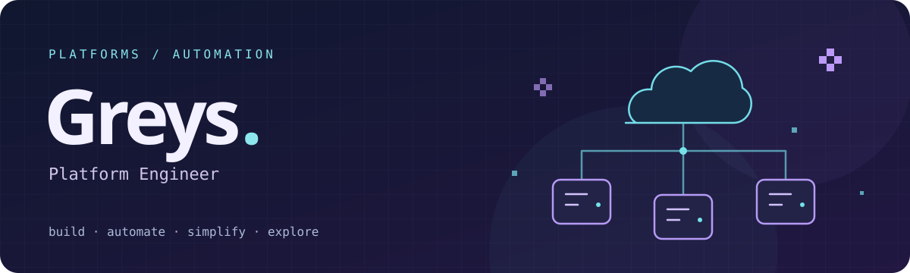

# Hi, I’m Greys — Platform Engineer.

**Building platforms. Automating the repetitive. Making room to create.**

Based in Argentina. I build and automate cloud platforms with Kubernetes and infrastructure as code. My focus is turning repetitive work into reusable workflows and making systems easier to build on and operate—with security, identity, and observability built in.

### Tools I work with

### What I focus on

- **Platform engineering** — making cloud infrastructure easier to build on and operate.
- **Automation** — turning repetitive tasks into reusable workflows.
- **Security** — building secure defaults and least-privilege access into platforms and workflows.
- **Identity and observability** — connecting access, metrics, and logs to everyday operations.

### Beyond infrastructure

I also explore creative coding and interactive visuals. Visual experiments give me another way to turn complex ideas into something tangible.

---

**Better platforms. Fewer manual steps. More room to experiment.**
